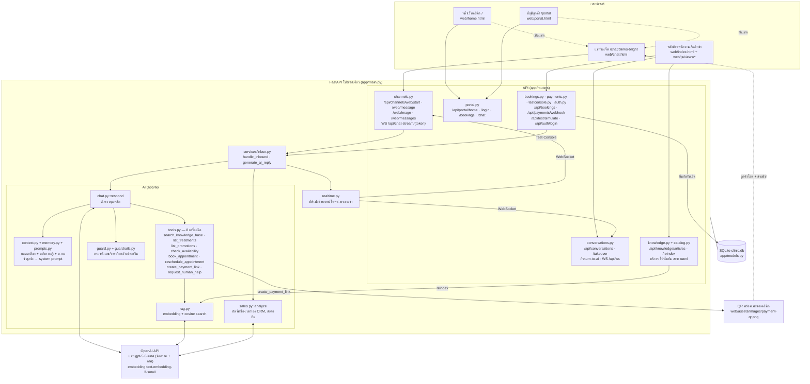
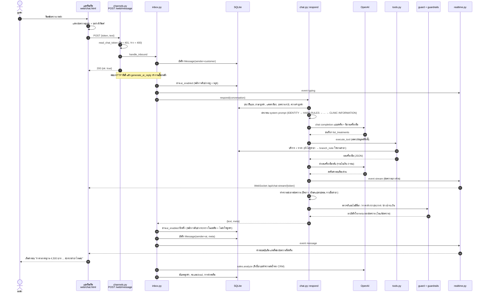

# แผนภาพสถาปัตยกรรมและการไหลของข้อมูล

แผนภาพทั้งสองแบบวาดจากโค้ดจริงในรีโพนี้ ทุกกล่องมีไฟล์หรือ endpoint จริงกำกับไว้
ไม่มีเทคโนโลยีที่ระบบไม่ได้ใช้ (ไม่มี message broker, ไม่มี vector database แยก, ไม่มี container)

แผนภาพเขียนด้วย Mermaid (GitHub แสดงผลให้เอง) และมีไฟล์ภาพสำหรับแนบรายงาน:
[diagrams/architecture.png](diagrams/architecture.png) · [diagrams/dataflow.png](diagrams/dataflow.png)

ระบบเป็น **FastAPI โปรเซสเดียว** (`python run.py` → uvicorn พอร์ต 8051) ใช้ **SQLite ไฟล์เดียว** (`clinic.db`)
และเรียก **OpenAI** เป็นบริการภายนอกเพียงตัวเดียว การชำระเงินใช้ **QR พร้อมเพย์** ของคลินิก (ไม่มีระบบตัดบัตร)

---

## 1. แผนภาพสถาปัตยกรรม (Architecture)

### ส่วนประกอบและหน้าที่

| ส่วนประกอบ | ไฟล์ | หน้าที่ |
|---|---|---|
| แชทวิดเจ็ต | `web/chat.html` | ข้อความต้อนรับ + ปุ่มลัด, ส่งข้อความ/รูป, แสดงจุดกำลังพิมพ์, ข้อความขัดข้อง + ปุ่มลองอีกครั้ง, รับคำตอบแบบสตรีมผ่าน WebSocket |
| API ฝั่งลูกค้า | `app/routers/channels.py`, `app/routers/portal.py` | รับข้อความ/รูปจากวิดเจ็ต, ตรวจ chat token, ข้อมูลหน้าเว็บ, บัญชีลูกค้า |
| ท่อรับ-ส่งข้อความ | `app/services/inbox.py` | บันทึกข้อความลูกค้า, สั่ง AI ตอบเป็นงานเบื้องหลัง, หยุด AI เมื่อพนักงานรับช่วง |
| ตัวควบคุม AI | `app/ai/chat.py` | ประกอบบริบท → เรียกโมเดล (สตรีม + เครื่องมือ ≤ 4 รอบ) → ทำความสะอาดข้อความ → ตรวจความปลอดภัย |
| บริบท/คลังความรู้ | `app/ai/context.py`, `app/ai/rag.py` | ใส่แคตตาล็อกทั้งหมด (สาขา บริการ ราคา โปรโมชัน แพทย์) ทุกครั้ง + บทความคลังความรู้ |
| เครื่องมือ | `app/ai/tools.py` | ทุกเครื่องมืออ่าน/เขียนเฉพาะข้อมูลของคลินิกนี้ |
| ด่านตรวจ | `app/ai/guard.py`, `app/ai/guardrails.py` | ตัวเลข 3 หลักขึ้นไปที่ไม่มีที่มา, ราคาต่ำกว่าที่ประกาศ, ของแถมที่ไม่มีจริง, อ้างว่าชำระแล้วทั้งที่ระบบไม่มีการชำระ |
| หลังบ้าน | `web/index.html` + `app/routers/conversations.py` ฯลฯ | กล่องข้อความรวม, รับช่วงจาก AI, ตรวจสลิป, แก้คลังความรู้/บริการ (เมนู 8 รายการ ดู GAP_ANALYSIS หัวข้อ 2) |

### คลังความรู้ (RAG) ทำงานอย่างไรในคลินิกนี้ — ตามที่โค้ดทำจริง

`context.py::build_context` ใส่ **แคตตาล็อกที่มีโครงสร้างทั้งหมด** ทุกครั้ง และใส่ **บทความคลังความรู้ทั้งหมด**
เมื่อขนาดรวมไม่เกิน `ARTICLE_TOKEN_BUDGET = 8000` token ถ้าเกินจึงเปลี่ยนไปใช้การค้นด้วย embedding (`rag.retrieve`, top-k 5)
คลังความรู้ของ Blinks Bright (16 บทความ) ประมาณ **889 token** จึงถูกใส่ทั้งชุดทุกข้อความ
การค้นด้วย embedding จึงเกิดขึ้นเมื่อโมเดลเรียกเครื่องมือ `search_knowledge_base` เท่านั้น
(เช่น Q8, Q10 ในบันทึกผลทดสอบ ซึ่ง `meta.tools` บันทึกไว้ว่าเรียก `search_knowledge_base`)
เมื่อแก้ไขบริการ/โปรโมชัน/บทความในหลังบ้าน ระบบจะ reindex embedding ใหม่ให้เองเบื้องหลัง

### endpoint ในแผนภาพ และหลักฐานว่าทำงาน

ทุก endpoint ด้านล่างถูกเรียกจริงใน [`tests/test_diagram_endpoints.py`](../tests/test_diagram_endpoints.py)
(ทำงานแบบออฟไลน์) และเส้นทางลูกค้าทั้งหมดถูกเรียกด้วยโมเดลจริงใน [`evals/deliverable.py`](../evals/deliverable.py)

| Method | Path | ใช้โดย |
|---|---|---|
| GET | `/`, `/chat/{slug}`, `/portal`, `/admin` | หน้าเว็บ |
| GET | `/api/health` | ตรวจว่าเซิร์ฟเวอร์ทำงาน |
| GET | `/api/portal/home?slug=` | หน้าเว็บคลินิก (ข้อมูลแคตตาล็อกเท่านั้น) |
| POST | `/api/channels/web/start` | วิดเจ็ตเปิดห้องแชท + ข้อความต้อนรับ |
| POST | `/api/channels/web/message` | ลูกค้าส่งข้อความ |
| POST | `/api/channels/web/image` | ลูกค้าส่งรูป (PNG/JPG/WebP ≤ 4 MB) |
| GET | `/api/channels/web/messages` | โหลดประวัติแชท / กู้ข้อความหลังเน็ตหลุด |
| WS | `/api/chat-stream/{token}` | สตรีมคำตอบไปที่วิดเจ็ต |
| POST | `/api/auth/login`, GET `/api/auth/me` | พนักงานเข้าสู่ระบบ |
| GET | `/api/conversations`, `/api/conversations/{id}` | กล่องข้อความรวม |
| POST | `/api/conversations/{id}/takeover`, `/messages`, `/return-to-ai` | พนักงานรับช่วง ตอบเอง แล้วคืนให้ AI |
| WS | `/api/ws` | อัปเดตกล่องข้อความแบบเรียลไทม์ |
| GET/POST | `/api/knowledge/articles`, `/api/knowledge/reindex` | จัดการคลังความรู้ |
| GET | `/api/bookings`, `/api/payments` | การจองและการชำระเงิน |
| POST | `/api/test/simulate`, GET `/api/test/webhooks` | Test Console (เมนูซ่อนแล้ว API ยังใช้ในเทสต์) |
| POST | `/api/payments/{id}/mark-paid` | พนักงานตรวจสลิปแล้วยืนยันรับเงิน (ยืนยันคิว + แจ้งลูกค้าในแชท) |

### มีในโค้ดแต่อยู่นอกขอบเขตเดโม

โค้ดรองรับหลายคลินิก (system console), LINE/Messenger webhook, broadcast, retention automation,
หน้า analytics และ scheduler งานเบื้องหลัง สิ่งเหล่านี้ทำงานได้และมีเทสต์ แต่ไม่ได้ใช้ในเส้นทางของโจทย์
จึงไม่วาดไว้ในแผนภาพ (เหตุผลอยู่ใน [GAP_ANALYSIS.md](GAP_ANALYSIS.md) หัวข้อ 2)

---

## 2. แผนภาพการไหลของข้อมูลของ 1 ข้อความ (Data Flow)

ตัวอย่าง: ลูกค้าพิมพ์ **"Pico Laser ราคาเท่าไหร่คะ"** ในแชทวิดเจ็ต (คือกรณี Q1 ในบันทึกผลทดสอบ)
แสดงเฉพาะขั้นที่เกิดขึ้นจริงตามลำดับในโค้ด

### กรณีส่งรูป

ต่างจากข้อความเพียงสองจุด: วิดเจ็ตเรียก `POST /api/channels/web/image` ซึ่งตรวจชนิด/ขนาดไฟล์ บันทึกรูปที่
`web/assets/images/chat-uploads/` แล้วแนบ path ไว้ใน `meta.image` ของข้อความ จากนั้น
`chat.py::_image_part` อ่านไฟล์ (ตรวจว่าอยู่ในโฟลเดอร์ที่อนุญาต) และส่ง**เฉพาะรูปล่าสุด**ให้โมเดลเป็น `image_url`
ส่วนขั้นตอนที่เหลือเหมือนข้อความทุกประการ

### เมื่อเกิดข้อผิดพลาด

| จุดที่ผิดพลาด | สิ่งที่เกิดขึ้นจริง |
|---|---|
| ส่งข้อความไม่ถึงเซิร์ฟเวอร์ (เน็ตหลุด, 5xx) | วิดเจ็ตลบจุดกำลังพิมพ์ แสดง "ส่งไม่สำเร็จ · ลองอีกครั้ง" ใต้ข้อความ กดแล้วส่งซ้ำ |
| chat token หมดอายุ/ผิด (401) | วิดเจ็ตแสดง "แชตนี้หมดอายุแล้ว กรุณากดปุ่มเริ่มแชตใหม่ด้านบน" |
| OpenAI ขัดข้อง หรือไม่มีคีย์ | `respond` คืนข้อความสำรอง `FALLBACK_TH` แทนการล่ม |
| งานเบื้องหลังล้มจนไม่มีคำตอบ | ครบ 60 วินาที วิดเจ็ตดึงประวัติใหม่ ถ้ายังไม่มีคำตอบจะแจ้งว่าระบบตอบช้าและให้ถามใหม่ |
| เน็ตหลุดระหว่างสตรีม | WebSocket ต่อใหม่ใน 2.5 วินาที แล้วดึงประวัติมาเติมข้อความที่พลาด |
